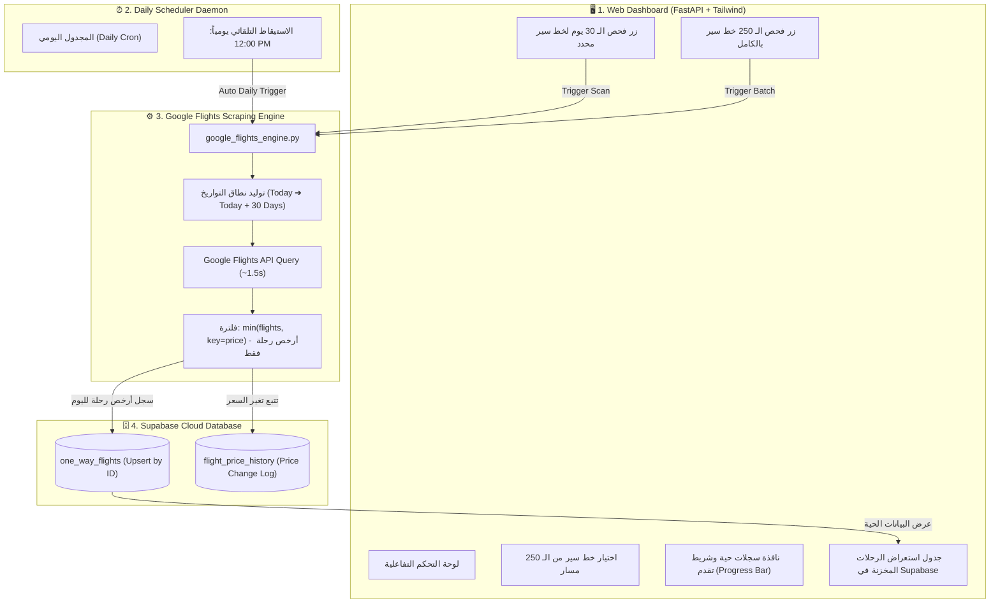

# ✈️ Google Flights Intelligence & Price Tracker
## خطة التنفيذ والمواصفات المعمارية الكاملة (Architecture & Implementation Plan)

---

> [!IMPORTANT]
> **القرار الاستراتيجي:** تم إلغاء التعامل مع منصة Hopper نهائياً بسبب تعقيدات التحقق والحظر (Cloudflare WAF / Token Expiry)، والتحول الكامل بنسبة 100% إلى **Google Flights Engine** الذي تم اختباره والتأكد من سرعته الفائقة (~1.5 ثانية لكل استعلام) ودقة أسعاره الحية بدون أي حظر.

---

## 🎯 الأهداف الأساسية للنظام (Core Objectives)

1. **محرك Google Flights**: استعلام مباشر وسريع جداً لجلب رحلات الطيران عبر بروتوكول Google Flights الداخلي.
2. **استخراج أرخص رحلة فقط لكل يوم (Cheapest Flight Only)**: حلقة فحص تغطي **30 يوماً متتالياً** (من تاريخ اليوم وحتى 30 يوماً قادمة) وحفظ أرخص سعر وحيد لكل يوم.
3. **تغطية 250 خط سير عالمي (Top 250 Global Routes)**: دعم كامل للـ 250 مسار الجوي المخزنة في `routes.json` مع إمكانية الفحص الفردي أو الفحص الدفعي (Batch Mode).
4. **الربط مع Supabase (Automated Sync & Upsert)**:
   - تخزين سجل أرخص رحلة في جدول `one_way_flights`.
   - تسجيل أي تغير أو انخفاض في الأسعار في جدول التاريخ `flight_price_history`.
5. **مجدول مهام يومي تلقائي (Daily Trigger at 12:00 PM)**: تشغيل أوتوماتيكي يومياً الساعة 12:00 ظهراً لتحديث الأسعار دون أي تدخل بشري.
6. **واجهة تحكم ويب متكاملة (Web Dashboard)**: تطبيق ويب سهل الاستخدام مبني بـ Python (FastAPI + Tailwind CSS) للتحكم التام بدون شاشات Terminal.

---

## 🏗️ المخطط المعماري للنظام (System Architecture)

---

## 📊 هيكل وتدفق البيانات (Data Specification & Flow)

### 1. استخراج أرخص رحلة لـ 30 يوماً
- يبدأ الفحص من تاريخ اليوم: $D_0 = \text{Current Date}$
- ينتهي عند: $D_{30} = D_0 + 30\text{ Days}$
- لكل يوم $d \in [D_0, D_{30}]$:
  1. إرسال استعلام إلى Google Flights للخط المحدد (Origin ➔ Destination).
  2. استقبال كافة العروض المتاحة (Direct & 1+ Stops).
  3. استخراج الرحلة ذات السعر الأدنى:
     $$\text{Cheapest Flight} = \arg\min_{f \in \text{Flights}} (f.\text{price})$$
  4. استخراج كافة تفاصيل الرحلة المختارة:
     - السعر بالدولار الأمريكي (`current_lowest_price`).
     - شركة الطيران والشعار (`airline`, `airline_code`).
     - تفاصيل المسار: رقم الرحلة، مطار الإقلاع والوصول، وقت الإقلاع والوصول، إجمالي مدة الرحلة، وعدد التوقفات.
     - رابط الحجز المباشر على Google Flights.

### 2. الربط مع قاعدة بيانات Supabase
يتم إنشاء معرف فريد ذكي لكل يوم ولكل خط لتفادي أي تكرار بيانات:
$$\text{Record ID} = \text{GF\_}\{\text{ORIGIN}\}\_\{\text{DEST}\}\_\{\text{YYYY-MM-DD}\}$$
*مثال:* `GF_CAI_DXB_2026-11-05`

| الحقل (Column) | النوع (Type) | الوصف |
| :--- | :--- | :--- |
| `id` | `VARCHAR(100) PRIMARY KEY` | المعرف الفريد المركب |
| `origin_code` | `VARCHAR(10)` | كود مطار المغادرة (مثال: CAI) |
| `destination_code`| `VARCHAR(10)` | كود مطار الوصول (مثال: DXB) |
| `departure_date` | `DATE` | تاريخ الرحلة (اليوم المستهدف) |
| `current_lowest_price` | `NUMERIC(10, 2)` | أقل سعر تم العثور عليه في هذا اليوم |
| `airline` | `TEXT` | شركة الطيران صاحبة أقل سعر |
| `stops` | `INTEGER` | عدد الوقفات (0 = Direct, 1, 2+) |
| `duration` | `TEXT` | إجمالي مدة الرحلة بالساعات والدقائق |
| `deep_link` | `TEXT` | رابط الحجز المباشر على Google Flights |
| `last_scraped_at`| `TIMESTAMP` | توقيت آخر فحص وتحديث للسعر |

> [!TIP]
> يتم تطبيق آلية **`UPSERT` (ON CONFLICT DO UPDATE)**: إذا تم فحص نفس اليوم غداً، يتم تحديث السعر الحالي وتسجيل السعر القديم والجديد في جدول `flight_price_history` لمراقبة اتجاه الأسعار (Price Drop / Increase).

---

## 🗺️ كتالوج الـ 250 خط سير (Top 250 Global Routes)

النظام مدعوم بالكامل بملف `routes.json` الذي يضم أكثر 250 خط سير نشاطاً حول العالم، مقسمة جغرافياً:
- **الشرق الأوسط والخليج**: (CAI-DXB, RUH-DXB, JED-CAI, DOH-LHR, ...)
- **أوروبا وأمريكا الشمالية**: (LHR-JFK, CDG-JFK, LAX-LHR, FRA-JFK, ...)
- **آسيا والمحيط الهادئ**: (SIN-KUL, HND-GMP, HKG-TPE, BKK-SIN, ...)
- **الرحلات الداخلية الرئيسية**: (JFK-LAX, SYD-MEL, HND-CTS, ...)

**استراتيجية تشغيل الـ 250 خط سير:**
- تشغيل ذكي مع فاصل زمني قابل للتعديل (0.5 ثانية بين كل استعلام) لضمان الاستقرار التام وسرعة الإنجاز.
- شريط تقدم مباشر في واجهة الويب يوضح: `تم إنجاز المسار X من أصل 250 | الرحلات المسجلة في Supabase: Y`.

---

## ⏰ مجدول المهام اليومي (Daily Scheduler at 12:00 PM)

- موديول مدمج `scheduler_service.py` يعمل في الخلفية بمجرد تشغيل التطبيق.
- محدد لتوقيت **12:00 PM** يومياً (توقيت محلي).
- بمجرد حلول الساعة 12:00 ظهراً:
  1. يبدأ فحص المسارات الـ 250 لكل أيام الـ 30 القادمة.
  2. يقوم بعملية مزامنة فورية مع Supabase لكل أرخص سعر.
  3. يرسل تقريراً وملخصاً يظهر في واجهة الويب: `اكتمل الفحص اليومي الساعة 12:00 PM - تم تحديث X رحلة`.
- توفير زر في لوحة التحكم: **"تشغيل الفحص الآن يدويًا (Force Run Now)"** دون الحاجة لانتظار الساعة 12:00.

---

## 💻 واجهة المستخدم التفاعلية (Web Dashboard Features)

1. **شريط الإحصائيات العلوي (KPIs Header)**:
   - إجمالي المسارات المدعومة (250).
   - إجمالي الرحلات المفحوصة في الـ 30 يوم الحالية.
   - حالة المجدول اليومي: `مفعّل - الفحص القادم: اليوم الساعة 12:00 PM`.
   - حالة الاتصال بقاعدة بيانات Supabase: `Connected 🟢`.
2. **لوحة التحكم السريعة (Scrape Controller)**:
   - قائمة منسدلة ذكية للـ 250 خط مع محرك بحث فوري بالاسم أو كود المطار.
   - زر: **"فحص أرخص رحلات الـ 30 يوم لهذا الخط"**.
   - زر: **"تشغيل فحص شامل للـ 250 مسار"**.
3. **شاشة السجلات وشريط التقدم (Live Terminal / Progress)**:
   - شريط تقدم ديناميكي بالنسبة المئوية.
   - نافذة كونسول أنيقة تظهر الرحلات التي يتم العثور عليها وتخزينها لحظة بلحظة.
4. **جدول استعراض الرحلات (Supabase Live Flights Table)**:
   - استعراض الرحلات مباشرة من Supabase.
   - إمكانية التصفية حسب المسار، التاريخ، نطاق السعر، أو شركة الطيران.
   - تمييز الأيام الأقل سعراً باللون الأخضر الجذاب.

---

## 🚀 خطة مراحل التنفيذ خطوة بخطوة (Execution Roadmap)

| المرحلة | الملفات المعنية | المهام المحددة |
| :--- | :--- | :--- |
| **1. بناء محرك Google Flights** | `google_flights_engine.py` | بناء دوال استعلام الـ 30 يوماً واستخراج أدنى سعر بدقة. |
| **2. ربط قاعدة البيانات** | `database.py` | تجهيز عمليات الـ Upsert لجدول `one_way_flights` وجدول السجل `flight_price_history`. |
| **3. خدمة الجدولة التلقائية** | `scheduler_service.py` | برمجة التكرار اليومي في تمام الساعة 12:00 PM مع دعم التشغيل اليدوي الفوري. |
| **4. تطوير لوحة التحكم** | `web_app.py` | إضافة واجهة الويب العصرية مع شريط التقدم، اختيار المسارات من الـ 250، وتكامل السيرفر. |
| **5. ملف الإطلاق والتجربة** | `Start_Flight_Tracker.bat` | ملف تشغيل بنقرة واحدة لتشغيل السيرفر والمجدول وفتح المتصفح تلقائياً. |

---

## 🏁 طريقة التشغيل المستقبلية

بمجرد اعتماد الخطة والانتهاء من التنفيذ، كل ما عليك هو:
1. النقر مرتين على ملف **`Start_Flight_Tracker.bat`**.
2. تفتح لوحة التحكم تلقائياً على متصفحك (`http://localhost:3000`).
3. تجد المجدول يعمل تلقائياً كل يوم الساعة 12:00 PM مع إمكانية الفحص اليدوي في أي لحظة.

