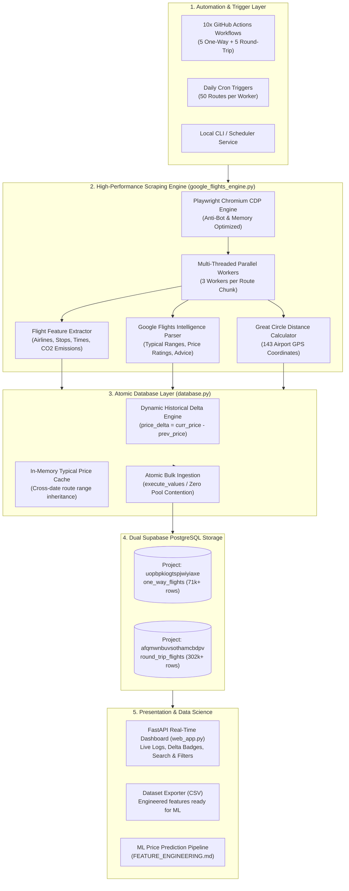

# Google Flights Price Scraper & Intelligence Tracker: Project Summary

## 1. Executive Summary

The **Google Flights Price Scraper & Intelligence Tracker** is an enterprise-grade automated data extraction, price tracking, and machine learning intelligence pipeline. It continuously monitors, extracts, and analyzes airfares across **250 top global flight routes** for both **One-Way** (30-day horizon) and **Round-Trip** (14-day horizon with dynamic return stay windows).

The platform tracks over **374,000+ validated flight records** stored in **Supabase PostgreSQL**, providing clean ground-truth data for airfare volatility analysis, deal detection, and machine learning price prediction models.

---

## 2. System Architecture



---

## 3. Core Subsystems

### A. High-Performance Scraping Engine (`google_flights_engine.py`)
- **Parallel Chunk Execution:** Divides date ranges across parallel Playwright worker threads for a 3x–5x scraping speedup.
- **Genuine Cheapest Selection:** Automatically clicks Google Flights' `"Cheapest"` sorting tab and evaluates candidates to ensure sponsored high-fare flights are excluded.
- **AJAX Visibility Synchronization:** Implements explicit element visibility waits (`wait_for(state="visible", timeout=4000)`) to eliminate DOM race conditions on high-latency international routes.
- **Google Price Intelligence Extraction:**
  - Extracts official Google predicted price brackets (`typical_price_min`, `typical_price_max`, `typical_price_range`).
  - Extracts Google flight ratings (`cheapest`, `low`, `typical`, `high`) and advice strings.
- **Carbon Footprint Tracking:** Parses live aircraft carbon emissions (`co2_kg`) directly from Google Flights flight cards.
- **Geographic Distance Integration:** Uses the Haversine formula with [`airports_coords.json`](file:///e:/downloads/hopper-flight-price-scraper-&-intelligence-tracker/airports_coords.json) to compute exact Great Circle flight distances (`distance_km`) for all 143 airport codes with zero network overhead.

### B. High-Performance Database Pipeline (`database.py`)
- **Dedicated Supabase Projects:**
  - **One-Way:** `postgres.uopbpkiogtspjwiyiaxe` (`one_way_flights`)
  - **Round-Trip:** `postgres.afqmwnbuvsothamcbdpv` (`round_trip_flights`)
  - Connected via AWS pooler host (`aws-0-eu-west-1.pooler.supabase.com:6543`).
- **Atomic Batch Ingestion (`execute_values`):** Replaced row-by-row commits with vectorized multi-row insert statements (`page_size=500`). This completely eliminates lock contention and connection pool exhaustion when multiple GitHub Actions workers scrape simultaneously.
- **Accurate Historical Delta Tracking:**
  - Pre-fetches the latest recorded price for `(origin_code, destination_code, departure_date)` for One-Way, and `(..., return_date)` for Round-Trip.
  - Automatically calculates `price_delta = round(curr_price - prev_price, 2)`.
  - Automatically defaults to `0.0` for new routes/dates.
- **Typical Price Range Inheritance:** Automatically inherits typical price bounds from previously scraped dates on the same route if Google Flights omits the insights card on a specific date.

### C. GitHub Actions Multi-Worker Automation (`.github/workflows/`)
The Top 250 global routes are partitioned across **10 independent GitHub Actions workflows**:
- **One-Way:** 5 workflows (`oneway_batch_1.yml` to `oneway_batch_5.yml`), each handling exactly 50 routes (30 days ahead).
- **Round-Trip:** 5 workflows (`roundtrip_batch_1.yml` to `roundtrip_batch_5.yml`), each handling exactly 50 routes (14 days ahead, return windows 1–14 days).
- **Scheduled Automation:** Runs on automated daily cron schedules with `workflow_dispatch` manual trigger support.

### D. Interactive Intelligence Web Dashboard (`web_app.py`)
- **FastAPI Backend:** Lightweight asynchronous API with Server-Sent Events (SSE) for live scraping logs.
- **Interactive UI:** Searchable, filterable table with real-time flight metrics, Google Flights deep links, color-coded price delta badges (`▲ +$X` / `▼ -$X`), and rating badges (`✦ CHEAPEST`, `LOW`, `TYPICAL`, `HIGH`).
- **Dataset Export:** One-click CSV export ready for machine learning feature training.
- **Cloud-Ready:** Pre-configured for deployment on **Vercel** (`api/index.py`, `vercel.json`) and **Docker** (`Dockerfile`, `docker-compose.yml`).

---

## 4. Canonical Database Schema (38 Columns)

All duplicate, composite, and legacy Hopper columns were permanently removed. Both tables now adhere to this clean, normalized schema:

| Category | Columns |
| :--- | :--- |
| **Route & Airports** | `id`, `origin_code`, `destination_code`, `origin_city`, `destination_city`, `origin_country`, `destination_country`, `departure_airport_name`, `arrival_airport_name` |
| **Dates & Scheduling** | `departure_date`, `return_date`, `departure_time`, `arrival_time`, `total_time`, `duration_minutes`, `days_before`, `day_of_week` |
| **Pricing & Intelligence** | `current_lowest_price`, `currency`, `price_delta`, `price_rating`, `price_labels`, `prediction_advice`, `typical_price_min`, `typical_price_max`, `typical_price_range` |
| **Flight Details** | `airline`, `airline_code`, `airline_logo`, `stops`, `stop_count`, `stop_details`, `is_self_transfer`, `adults`, `source_url` |
| **Ground-Truth Metrics** | `distance_km` *(Haversine Great Circle distance)*, `co2_kg` *(Google Flights carbon emission)* |
| **Audit Metadata** | `scraped_at` *(TIMESTAMPTZ)* |

---

## 5. Machine Learning & Feature Engineering (`FEATURE_ENGINEERING.md`)

The pipeline strictly adheres to the **Ground-Truth Storage Principle**: only data that cannot be derived from existing columns is stored in PostgreSQL.

All derived features for Machine Learning model training are fully specified in [`FEATURE_ENGINEERING.md`](file:///e:/downloads/hopper-flight-price-scraper-&-intelligence-tracker/FEATURE_ENGINEERING.md) with exact SQL formulas and Python (Pandas) code:

1. **`haul_type`** (`short-haul` < 1500km, `medium-haul` 1500–4000km, `long-haul` > 4000km)
2. **`is_international`** (`origin_country != destination_country`)
3. **`is_weekend`** (`day_of_week IN ('Friday', 'Saturday', 'Sunday')`)
4. **`departure_month` & `departure_quarter`** *(Seasonal demand variance)*
5. **`departure_period`** (`night`, `morning`, `afternoon`, `evening`)
6. **`trip_duration_days`** (`return_date - departure_date` for round trips)
7. **`price_per_km`** (`current_lowest_price / distance_km`)
8. **`effective_speed_kmh`** (`distance_km / (duration_minutes / 60)`)
9. **`typical_price_midpoint` & `discount_pct`** *(Deal magnitude relative to Google's benchmark)*

---

## 6. Dataset Scale & Quality Verification

| Metric | `one_way_flights` | `round_trip_flights` | Total |
| :--- | :--- | :--- | :--- |
| **Total Stored Records** | **71,723** | **302,721** | **374,444** |
| **Total Canonical Columns** | **38** | **38** | — |
| **Critical Columns NULL Count** | **0 NULLs (100% Complete)** | **0 NULLs (100% Complete)** | **0 Errors** |
| **`distance_km` Backfill** | **100% Populated** | **100% Populated** | **374,444 Rows** |
| **Price Sanity (Fares $\le 0$)** | **0 Invalid** (Min: \$17, Avg: \$260) | **0 Invalid** (Min: \$10, Avg: \$516) | **0 Errors** |
| **Price Delta Tracked Fares** | **33,030 active deltas** | **234,359 active deltas** | **267,389 deltas** |
| **Date Consistency (`ret < dep`)** | N/A | **0 errors (100% valid)** | **0 Errors** |

---

## 7. Project File Directory

```
├── google_flights_engine.py  # Playwright parallel scraper & Google Flights Intelligence parser
├── database.py               # Supabase PostgreSQL atomic batch ingestion & delta engine
├── web_app.py                # FastAPI web dashboard, live log streaming & CSV export
├── routes.py / routes.json   # Top 250 global flight route catalog
├── airports_coords.json      # GPS coordinates database for all 143 route airports
├── FEATURE_ENGINEERING.md    # Machine Learning feature engineering specifications
├── PROJECT_SUMMARY.md        # Comprehensive executive & technical architecture summary
├── scheduler_service.py      # Background scheduled scraping daemon
├── run_250_routes.py         # Standalone batch execution CLI runner
├── .github/workflows/        # 10 Sharded GitHub Actions workflows (5 One-Way + 5 Round-Trip)
│   ├── oneway_batch_1.yml .. oneway_batch_5.yml
│   └── roundtrip_batch_1.yml .. roundtrip_batch_5.yml
├── Dockerfile                # Production container definition (Playwright + Chrome)
├── docker-compose.yml        # Multi-container orchestration definition
└── vercel.json               # Vercel cloud dashboard deployment configuration
```

---

## 8. Git Repository Information

- **Repository:** `https://github.com/MohamedAlaa2005/google-flights-tracker.git`
- **Primary Branch:** `main`
- **Workspaces:**
  - `e:\downloads\hopper-flight-price-scraper-&-intelligence-tracker`
  - `e:\price_prediction`
