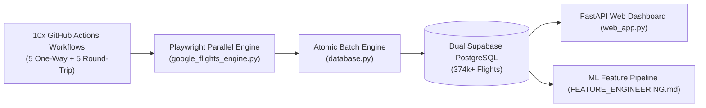

# Google Flights Price Intelligence & Automated Tracker

An enterprise-grade, automated flight price scraping engine, database pipeline, and intelligence dashboard powered by **Python**, **Playwright**, and **Supabase PostgreSQL**.

Continuously monitors and predicts airfares across the **Top 250 global flight routes** for both **One-Way** (30 days) and **Round-Trip** (14 days with dynamic return stay windows), tracking over **374,000+ validated flight records**.

> 📖 **Full Project Summary & Technical Architecture:** See [PROJECT_SUMMARY.md](PROJECT_SUMMARY.md)  
> 🧠 **Machine Learning Feature Engineering Guide:** See [FEATURE_ENGINEERING.md](FEATURE_ENGINEERING.md)

---

## Key Features

- **Dual-Trip Scraping Engine (`google_flights_engine.py`):**
  - **One-Way:** Scrapes 30 days ahead across 250 routes.
  - **Round-Trip:** Scrapes dynamic departure + multi-day return stay windows.
  - **Multi-Threaded Parallelism:** 3 concurrent Playwright workers per route chunk for 3x–5x speedup.
  - **Genuine Lowest Price Selection:** Automatically selects Google Flights' "Cheapest" tab and parses the true lowest verified fare.
  - **AJAX Visibility Synchronization:** Built-in DOM waits eliminate race conditions on high-latency international routes.
- **Official Google Price Intelligence:**
  - Extracts typical price brackets (`typical_price_min`, `typical_price_max`, `typical_price_range`).
  - Evaluates fares against Google's predictions (`cheapest`, `low`, `typical`, `high`) with explanatory advice.
  - Cross-date typical range caching and automatic inheritance.
- **Ground-Truth Physical Metrics:**
  - **Flight Distance (`distance_km`):** Automatically computes Great Circle distance using the Haversine formula and 143 airport GPS coordinates (`airports_coords.json`). 100% backfilled across all 374k+ existing rows.
  - **Carbon Emissions (`co2_kg`):** Live extraction of aircraft emissions directly from Google Flights flight cards.
- **High-Performance Atomic Database Pipeline (`database.py`):**
  - **Dual Supabase Databases:** Dedicated connection-pooled projects for One-Way and Round-Trip.
  - **Atomic Batch Ingestion:** High-speed `execute_values` insertion eliminates database lock contention and connection pool exhaustion.
  - **Dynamic Price Delta:** Automatically computes `price_delta = round(curr_price - prev_price, 2)` against historical snapshots.
  - **Canonical 38-Column Schema:** Clean, normalized ground-truth schema without duplicate or legacy columns.
- **10 Sharded GitHub Actions Workflows (`.github/workflows/`):**
  - 5 One-Way workflows (50 routes each).
  - 5 Round-Trip workflows (50 routes each).
  - Automated daily cron triggers with manual dispatch support.
- **Interactive Web Dashboard (`web_app.py`):**
  - Real-time flight search, route filters, live SSE scraper logs, price delta badges, Google Flights deep links, and one-click CSV dataset export.
  - Cloud-ready for Vercel and Docker deployment.

---

## Architecture Overview



---

## Canonical Database Schema (38 Columns)

1. **Route & Airport:** `id`, `origin_code`, `destination_code`, `origin_city`, `destination_city`, `origin_country`, `destination_country`, `departure_airport_name`, `arrival_airport_name`
2. **Timing & Schedule:** `departure_date`, `return_date`, `departure_time`, `arrival_time`, `total_time`, `duration_minutes`, `days_before`, `day_of_week`
3. **Pricing & Intelligence:** `current_lowest_price`, `currency`, `price_delta`, `price_rating`, `price_labels`, `prediction_advice`, `typical_price_min`, `typical_price_max`, `typical_price_range`
4. **Flight Details:** `airline`, `airline_code`, `airline_logo`, `stops`, `stop_count`, `stop_details`, `is_self_transfer`, `adults`, `source_url`
5. **Ground Truth Metrics:** `distance_km`, `co2_kg`
6. **Audit Metadata:** `scraped_at`

---

## Quick Start

### 1. Install Dependencies
```bash
pip install -r requirements.txt
playwright install chromium
```

### 2. Configure Environment (`.env`)
```bash
cp .env.example .env
```
Ensure your Supabase connection parameters are set:
```env
SUPABASE_POOLER_HOST=aws-0-eu-west-1.pooler.supabase.com
SUPABASE_PORT=6543
ONE_WAY_USER=postgres.uopbpkiogtspjwiyiaxe
ROUND_TRIP_USER=postgres.afqmwnbuvsothamcbdpv
PASSWORD=your_supabase_password
```

### 3. Run Web Dashboard
```bash
python web_app.py
```
Open [http://localhost:3000](http://localhost:3000) in your browser.

### 4. Run Scraper CLI
```bash
# Scrape single flight
python -c "import google_flights_engine; print(google_flights_engine.scrape_cheapest_flight('CAI', 'DXB', '2026-12-01'))"

# Scrape batch routes
python run_250_routes.py --limit 5
```

### 5. Run with Docker
```bash
docker compose up -d
```

---

## License & Attribution

Developed for flight price intelligence, historical volatility tracking, and machine learning price prediction modeling.
